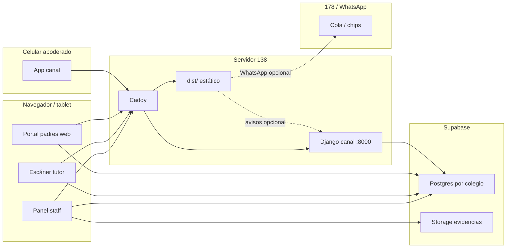

# SIE — cómo funciona el sistema a fondo (estado actual)

Documento de referencia del **Sistema de Incidencias Escolares (SIE / Asiscole)** tal como opera **hoy** (octubre 2026).  
No describe la arquitectura futura de microservicios; describe lo que está en producción y en el código desplegado.

Fuentes: esquema vivo de la base Jean Piaget, rutas de `src/App.tsx`, navegación staff, servicios y canal Django en el servidor `138.201.203.50`.

---

## 1. Visión general

SIE es una aplicación web por colegio para:

| Área | Qué hace |
|------|----------|
| **Incidencias** | Registrar faltas, reincidencia, evidencias, justificación/anulación, impresión |
| **Asistencia** | Llegadas, tardanzas, salidas, justificaciones, compromisos de alarma |
| **Estudiantes** | Ficha, código de barras (DNI/carnet), contacto, foto, pensión |
| **Padres** | App móvil (canal) + portal web limitado; citas; avisos |
| **Reportes** | Dashboard, reportes de incidencias/asistencia, Excel/PDF |
| **Pensiones** | Configuración, importación, estado por alumno (si el feature está activo) |
| **Talleres** | Tablas y llegadas de taller (feature opcional; en JP las tablas existen) |
| **Administración** | Usuarios staff, auditoría, configuración, catálogo de faltas |

Cada colegio tiene:

1. Un **frontend React** (SPA estática) en su dominio.
2. Una **base Postgres en Supabase** propia.
3. Acceso compartido al **canal** (Django) para la app de apoderados y la cola de avisos.

---

## 2. Cómo está funcionando ahora (producción)

### 2.1 Colegios y URLs

| Colegio | URL | Frontend en servidor | Base Supabase (ref) |
|---------|-----|----------------------|---------------------|
| Jean Piaget | https://jeanpiaget.asiscole.com | `/opt/sie-jp` en **138.201.203.50** | proyecto JP (producción real) |
| Miguel Grau | https://miguelgrau.asiscole.com | `/opt/sie-miguelgrau` | base de prueba (datos JP anonimizados cargados) |
| Abraham Valdelomar | https://abraham.asiscole.com | `/opt/sie-abraham` | base propia de prueba |
| San Ramón | (VPS Cloud) | en **178.104.115.2** | base SR |

### 2.2 Infraestructura

| Pieza | Dónde | Rol |
|-------|--------|-----|
| Servidor dedicado | `138.201.203.50` (Hetzner, hostname `asiscole-ded1`) | Jean Piaget, Miguel Grau, Abraham, canal Django, Caddy |
| VPS Cloud | `178.104.115.2` | San Ramón, WhatsApp (WPPConnect / notify) |
| Base de datos | Supabase (Postgres gestionado) | Una BD por colegio; no vive en el VPS |
| Proxy / TLS | Caddy + Cloudflare (proxy naranja) | SPA + `/canal-api` → Django `:8000` |
| App apoderados | Contenedor `asiscole_canal_backend` | Login por teléfono + código, push, directorio, outbox |

### 2.3 Stack del panel

| Capa | Tecnología |
|------|------------|
| Build | Vite 5 |
| UI | React 18 + TypeScript + Tailwind + shadcn/ui |
| Routing | React Router v6 |
| Datos remotos | TanStack Query (caché ~5 min) |
| Backend de datos | Supabase PostgREST + RPC SQL (`sie_*`) |
| Auth panel | RPC `sie_iniciar_sesion` + token `x-sie-token` + RLS |
| Export | ExcelJS, jsPDF |
| Gráficos | Recharts |

### 2.4 Diagrama de flujo actual



Regla clave: **el panel habla directo con Supabase**. El canal es un backend aparte para la app familiar y la ingesta/push; no es el API general del panel.

---

## 3. Autenticación y sesiones

### 3.1 Personal del colegio (panel web)

1. Login en `/login` con usuario y contraseña.
2. RPC `sie_iniciar_sesion` valida (bcrypt o texto plano legacy vía `validar_password`).
3. Se crea fila en `app_sesiones` (token hasheado).
4. El cliente guarda en **sessionStorage** el usuario + token API.
5. Cada request Supabase lleva header `x-sie-token`.
6. RLS / funciones `sie_es_staff_sesion`, `sie_sesion_rol`, etc. autorizan.

| Rol | Idle típico | Destino al entrar |
|-----|-------------|-------------------|
| Admin / Director / Supervisor | 30 min | `/dashboard` |
| Tutor | 45 min | `/tutor-scanner` |
| Padre (web) | 15 min | `/parent-portal` |

Cerrar la pestaña borra la sesión del navegador. En servidor el token sigue hasta expirar o `sie_cerrar_sesion`.

### 3.2 Apoderados (app móvil / canal)

- Identidad: **teléfono** (E.164) + **código de barras** del estudiante.
- El teléfono se busca en `estudiantes.telefono_contacto` **o** `telefono_emergencia`.
- Tabla central del canal: `asis_directorio` (proyección teléfono ↔ estudiante ↔ tenant).
- Sesión activa única por cuenta (`asis_sesion_activa`); ~10 días (`SESSION_TOKEN_DAYS`).
- A las **02:30** corre `reconciliar_directorio` (incluye emergencia).
- A las **06:00** se precalienta la caché Redis del directorio.
- Mensajes: purga/anonimizado solo tras **24 meses** (`MESSAGE_RETENTION_MONTHS`), no cada noche.

### 3.3 Roles del panel

| Rol | Qué puede |
|-----|-----------|
| **Admin** | Todo: auditoría, configuración, catálogos, reportes, pensiones |
| **Director** | Operación + reportes + catálogo + pensiones; no auditoría/config profunda |
| **Supervisor** | Operación diaria: asistencia, incidencias, estudiantes, citas, reportes básicos |
| **Tutor** | Solo escáner (`/tutor-scanner`), grados en `usuarios.grados_asignados` |
| **Padre** | Portal web de consulta (poco usado en JP; la app canal es el canal real) |

---

## 4. Páginas del frontend (ruta por ruta)

Definidas en `src/App.tsx` y menú en `src/config/staffNavigation.ts`.

### 4.1 Públicas / especiales

| Ruta | Página | Función actual |
|------|--------|----------------|
| `/login` | `Login` | Entrada staff/tutor/padre web |
| `/cambiar-password` | `ChangePassword` | Cambio obligatorio o voluntario |
| `/portal-padres` | `ParentDniPortal` | Acceso público por DNI (flujo legacy/alterno) |
| `/llegada/:id` y `/llegada/dni/:dni` | `ArrivalView` | Vista de llegada (enlace / carnet) |
| `*` | `NotFound` | 404 |

### 4.2 Staff (layout con sidebar)

| Ruta | Página | Roles | Qué hace hoy |
|------|--------|-------|--------------|
| `/dashboard` | `Dashboard` | Sup/Dir/Admin | KPIs del año escolar, tendencia mensual, reincidencia, alertas de salida, accesos rápidos. Prefiere RPC `sie_reportes_bundle` |
| `/arrival-control` | `ArrivalControl` | Sup/Dir/Admin | Control de llegadas del día/fecha |
| `/departure-control` | `DepartureControl` | Sup/Dir/Admin | Registro de salidas |
| `/justify-attendance` | `JustifyAttendance` | Sup/Dir/Admin | Justificar tardanzas/inasistencias |
| `/compromisos-alarma` | `CompromisosAlarma` | Sup/Dir/Admin | Compromisos firmados por alarma de deuda/asistencia |
| `/incidents` | `IncidentsList` | Sup/Dir/Admin | Lista, filtros, detalle, anular, imprimir, Excel |
| `/register` | `RegisterIncident` | Sup/Dir/Admin | Nueva incidencia (código/nombre + falta + obs + fotos) |
| `/justify-faults` | `JustifyFaults` | Sup/Dir/Admin | Justificar incidencias activas |
| `/students` | `StudentsList` | Sup/Dir/Admin | CRUD estudiantes, contacto, foto, filtros |
| `/parent-meetings` | `ParentMeetings` | Sup/Dir/Admin | Citas con padres |
| `/faults` | `FaultsCatalog` | Dir/Admin | Catálogo de faltas + recomendación WhatsApp |
| `/reports` | `Reports` | Dir/Admin (nav también Sup en menú reportes parcial) | Reportes de incidencias agregados |
| `/attendance-report` | `AttendanceReport` | Sup/Dir/Admin | Matriz de asistencia |
| `/integral-report` | `IntegralStudentReport` | Sup/Dir/Admin | Ficha integral del alumno |
| `/pensiones` | `PensionesAdmin` | Dir/Admin | Solo si `VITE_PENSIONES_ENABLED=true` |
| `/audit` | `AuditLogs` | Admin | Auditoría INSERT/UPDATE/DELETE |
| `/system-config` | `SystemConfig` | Admin | Horarios, feriados, reincidencia, parámetros |

### 4.3 Tutor

| Ruta | Página | Función |
|------|--------|---------|
| `/tutor-scanner` | `TutorScanner` | Escaneo rápido: llegada/salida/incidencia; índice de códigos en memoria; WhatsApp en background |

### 4.4 Padres web

| Ruta | Página | Función |
|------|--------|---------|
| `/parent-portal` | `ParentPortalRoute` | Consulta asistencia/incidencias del hijo vinculado |

### 4.5 Menú sidebar (agrupado)

1. **Inicio** → dashboard  
2. **Asistencia** → llegadas, salidas, justificar asistencia, compromisos  
3. **Incidencias** → lista, registrar, justificar faltas  
4. **Estudiantes**  
5. **Citas con Padres**  
6. **Catálogos** → faltas  
7. **Reportes** → incidencias, asistencias, integral  
8. **Pensiones** (feature flag)  
9. **Administración** → auditoría, configuración  

---

## 5. Capa de servicios (frontend)

Todo acceso a datos pasa por `src/lib/services/` (no desde páginas directo a Supabase, por convención).

| Servicio | Responsabilidad |
|----------|-----------------|
| `authService` | Login/logout, usuario actual |
| `sessionService` | sessionStorage, idle, token |
| `studentsService` | Estudiantes, índice de códigos, CRUD |
| `faultsService` | Catálogo de faltas |
| `incidentsService` | Incidencias y filtros |
| `evidenceService` | Fotos → Storage |
| `commentsService` | Comentarios |
| `dashboardService` | KPIs / tendencias (`sie_reportes_bundle`) |
| `arrivalService` | Llegadas, salidas, alertas |
| `parentMeetingsService` | Citas |
| `parentPortalService` | Portal padres |
| `auditService` | Logs de auditoría |
| `configService` / `reincidenceConfigService` / `holidaysService` / `scheduleService` | Configuración |
| `pensionesService` | Pensiones |
| `talleresService` / `tallerAttendanceService` | Talleres |
| `whatsappService` | Avisos WhatsApp / meta / cola |
| `mobileIngest` | Empuje de avisos al canal |

Cliente: `src/lib/supabaseClient.ts` (inyecta `x-sie-token`).

---

## 6. Base de datos — tablas (Jean Piaget vivo)

Conteos tomados del esquema en producción JP. Otras escuelas tienen el mismo modelo con menos filas.

### 6.1 Núcleo académico / disciplina

#### `estudiantes` (743)

Ficha del alumno. El **código de barras** es el identificador de carnet/DNI usado en escáner y app.

| Columna | Tipo | Uso |
|---------|------|-----|
| `id_estudiante` | int PK | ID interno |
| `codigo_barras` | varchar UNIQUE | Carnet / DNI escolar |
| `nombre_completo` | varchar | Nombre |
| `grado`, `seccion` | varchar | Salón |
| `nivel_educativo` | enum Primaria/Secundaria | Nivel |
| `foto_perfil` | text | URL foto (Storage) |
| `activo` | bool | Soft-delete lógico |
| `telefono_contacto` | varchar | Celular principal apoderado |
| `telefono_emergencia` | varchar | Celular alterno (también sirve para login canal) |
| `email_contacto`, `nombre_responsable`, `parentesco_responsable` | | Contacto familiar |
| `estado_pension` | text | al_dia / pendiente / moroso / sin_dato |
| `cuidado_especial`, `condicion_especial_nota` | | Alertas de cuidado |
| `fecha_creacion`, `fecha_actualizacion` | timestamptz | Auditoría básica |

#### `catalogo_faltas` (18)

Tipos de falta disciplinaria.

| Columna | Uso |
|---------|-----|
| `nombre_falta`, `categoria`, `es_grave` | Clasificación |
| `puntos_reincidencia` | Peso en el algoritmo |
| `recomendacion` | Texto para WhatsApp al apoderado |
| `activo`, `orden_visualizacion` | UI |

#### `incidencias` (2273)

Registro de una falta a un alumno.

| Columna | Uso |
|---------|-----|
| `id_estudiante`, `id_falta` | Quién / qué |
| `fecha_hora_registro`, `id_usuario_registro` | Cuándo / quién registró |
| `nivel_reincidencia` | 0–5 al momento del alta |
| `observaciones` | Texto libre |
| `estado_evidencia`, `cantidad_fotos`, carga foto | Evidencias |
| `estado` | Activa / Anulada / En revisión / Justificada |
| `motivo_anulacion`, usuario/fecha anulación | Anulación |
| `veces_impreso`, `fecha_ultima_impresion` | Impresión |
| `taller_id` | Si nació en un taller |
| `revisado_app`, `confirmada_app` (+ timestamps) | App apoderado |

#### `evidencias_fotograficas` (20)

Metadatos de fotos; el binario está en **Supabase Storage** (`ruta_archivo`).

#### `comentarios_incidencias` (0)

Comentarios staff sobre una incidencia.

#### `configuracion_reincidencia` (1)

Ventana en días, puntos leve/grave, umbrales nivel 1–5.

### 6.2 Asistencia

#### `registros_llegada` (14754)

Una fila por alumno y fecha (UNIQUE estudiante+fecha).

| Columna | Uso |
|---------|-----|
| `fecha`, `hora_llegada`, `estado` | A tiempo / Tarde / etc. |
| `registrado_por` | Usuario staff/tutor |
| `hora_salida`, `tipo_salida`, `registrado_salida_por`, `fecha_salida` | Salida |
| `motivo_justificacion`, `justificado_por`, `fecha_justificacion` | Justificación |

#### `calendario_no_lectivo` (16)

Feriados / no lectivos (fecha UNIQUE).

#### `compromisos_alarma` (1)

Compromisos firmados (tipo, apoderado, documento URL, activo).

### 6.3 Padres y citas (panel)

#### `citas_padres` (24)

Citas agenda: motivo, fecha/hora, estado, asistencia, llegada tarde, notas, creador.

#### `padres_estudiantes` (0 en JP)

Vínculo usuario web `Padre` ↔ estudiante. En JP la app canal no depende de esta tabla.

### 6.4 Usuarios y sesión panel

#### `usuarios` (29)

| Columna | Uso |
|---------|-----|
| `username` UNIQUE, `password_hash` | Credenciales |
| `nombre_completo`, `email`, `rol` | Perfil |
| `grados_asignados` | JSON (tutores) |
| `activo`, `cambio_password_obligatorio` | Control |
| `intentos_fallidos`, `bloqueado_hasta`, `ultimo_acceso` | Seguridad login |

#### `app_sesiones` (pocas filas vivas)

Token hasheado, usuario, rol, `expires_at`.

#### `tokens_recuperacion` (0)

Reset de contraseña.

### 6.5 Auditoría y cola de avisos

#### `auditoria_logs` (~33k)

Triggers escriben INSERT/UPDATE/DELETE (sobre todo `registros_llegada` e `incidencias`).  
Campos: usuario, tabla, id, acción, JSON antes/después, IP, user-agent, fecha.

#### `asis_outbox` (~31k)

Cola hacia el canal / avisos: `tipo` (entrada/salida/incidencia), estudiante, registro, `payload` JSON, `procesado`, intentos, errores.  
Único por (`tipo`, `id_registro`) a nivel de evento.

### 6.6 Pensiones

| Tabla | Filas JP | Uso |
|-------|----------|-----|
| `pensiones` | 0 | Estado por alumno y periodo |
| `pensiones_config` | 1 | Día vencimiento, monto, moneda, aviso sonoro |
| `pensiones_import_log` | 10 | Historial de imports Excel/PDF |

### 6.7 Talleres

| Tabla | Filas JP | Uso |
|-------|----------|-----|
| `talleres` | 0 | Definición de taller |
| `taller_inscritos` | 0 | Inscripción alumno–taller |
| `taller_asistencias` | 0 | Asistencia por taller |
| `taller_llegadas` | 1012 | Llegadas/salidas de taller (flujo usado aunque `talleres` esté vacío en algunos casos) |

### 6.8 Configuración

#### `configuracion_sistema` (6)

Clave/valor (horas límite, flags, etc.).

---

## 7. Funciones RPC importantes (`sie_*`)

Expuestas a `anon`/`authenticated` con controles internos de sesión.

| Grupo | Funciones (ejemplos) |
|-------|----------------------|
| Sesión | `sie_iniciar_sesion`, `sie_cerrar_sesion`, `sie_renovar_sesion`, `sie_tiene_sesion`, `sie_cambiar_password`, `sie_solicitar_reset_password` |
| Autorización | `sie_es_staff_sesion`, `sie_sesion_rol`, `sie_sesion_usuario_id`, `sie_request_token`, `sie_padre_puede_ver_estudiante` |
| Estudiantes | `sie_lista_estudiantes`, `sie_crear_estudiante`, `sie_actualizar_estudiante`, `sie_buscar_estudiante_carnet`, `sie_buscar_estudiantes_nombre`, `sie_estudiante_por_id` |
| Reportes | `sie_reportes_bundle` (dashboard/reportes en una lectura) |
| JP asistencia | `sie_jp_marcar_faltas_dia`, `sie_jp_check_tardanza_reiterada` |
| Pensiones | `sie_pensiones_*` |
| App | `sie_marcar_incidencia_revisada_app` |
| Auditoría | `sie_auditoria_pagina`, `sie_auditoria_stats` |
| Citas | `sie_crear_cita_individual`, `sie_sugeridos_citar` |
| Docentes | `sie_admin_crear_docente`, `sie_admin_listar_docentes`, `sie_docente_listar_estudiantes_salon` |

También existen helpers internos `_sie_*` y `validar_password` / `calcular_nivel_reincidencia`.

---

## 8. Flujos de negocio principales

### 8.1 Llegada (tutor o staff)

1. Se lee `codigo_barras` → `estudiantes`.
2. Insert/upsert en `registros_llegada` (estado según hora límite por nivel).
3. Trigger de auditoría.
4. Fila en `asis_outbox` tipo `entrada` (si aplica).
5. WhatsApp / push canal en background (`whatsappService` / `mobileIngest`).

### 8.2 Incidencia

1. Staff/tutor elige falta del catálogo.
2. Insert en `incidencias`; trigger calcula `nivel_reincidencia`.
3. Fotos opcionales → Storage + `evidencias_fotograficas`.
4. Outbox tipo `incidencia` + aviso al celular del contacto/emergencia.
5. En app: flags `revisado_app` / `confirmada_app`.

### 8.3 Reincidencia

1. Config en `configuracion_reincidencia` (ventana, puntos, umbrales).
2. Al crear incidencia se suman puntos de faltas **activas** en la ventana.
3. Se asigna nivel 0–5; UI con `ReincidenceBadge`.

### 8.4 Dashboard

1. Rango = año escolar (marzo → hoy, zona Lima).
2. Ideal: una llamada a `sie_reportes_bundle` (rápido, SECURITY DEFINER + check de sesión).
3. Fallback: conteos/páginas PostgREST (puede degradarse con mucha data).
4. “Tasa de resolución” UI = proporción de incidencias activas que **no son de hoy** (no es % justificadas).

### 8.5 Login apoderado (canal)

1. Normaliza teléfono.
2. Busca en directorio (Redis → `asis_directorio` → BD colegio `telefono_contacto`/`telefono_emergencia`).
3. Pide código de barras del hijo.
4. Crea/renueva `SesionActiva` (una por cuenta).
5. Entrega tokens de sesión/datos.

---

## 9. Canal Django (app familiar) — piezas clave

Corre en el mismo host 138, detrás de `/canal-api`.

| Concepto | Descripción |
|----------|-------------|
| Tenants | `SCHOOL_DATABASES` JSON (jean_piaget, etc.) |
| Directorio | `asis_directorio` + caché Redis |
| Reconciliación | Celery 02:30 — upsert desde colegio; marca inactivos solo si ya no existen en origen |
| Precalentado | Celery 06:00 — cache de teléfonos activos |
| Outbox poll | Cada ~10 s `poll_outbox_colegios` |
| Mensajería | Inbox en app; retención 24 meses |
| Push | Tokens por dispositivo |

El panel **no** usa el canal para CRUD de incidencias; el canal consume outbox y publica avisos.

---

## 10. WhatsApp y notificaciones

Config por variables `VITE_OPENWA_*`, `VITE_WPPCONNECT_*`, `VITE_META_WA_*`, `VITE_MOBILE_INGEST_*`.

| Colegio típico | Canal de aviso |
|----------------|----------------|
| Jean Piaget | Outbox → canal + (según config) WhatsApp en 178 |
| Miguel Grau / Abraham | Panel apunta a su BD; canal tenant a veces aún no registrado para push |
| San Ramón | WPPConnect / chips en VPS 178 |

Mensaje típico: número del apoderado + texto de llegada/salida/incidencia (+ `recomendacion` del catálogo).

---

## 11. Seguridad (cómo está hoy)

| Medida | Estado |
|--------|--------|
| RLS + token `x-sie-token` | Activo en panel |
| Contraseñas | bcrypt preferido; legacy texto plano aún aceptado por `validar_password` |
| sessionStorage | Sí (se limpia al cerrar pestaña) |
| Idle timeout | 15/30/45 min según rol |
| Service role | Solo servidor/scripts; **nunca** en Vite |
| Auditoría | Triggers → `auditoria_logs` |
| Storage evidencias | Buckets Supabase con políticas |
| Backups BD | Responsabilidad Supabase; RAID del VPS no es backup de datos |

---

## 12. Despliegue actual

### Jean Piaget (138)

- Código desde GitHub `main` del repo JP.
- Script/cron `/opt/sie-jp/deploy.sh` (pull + `npm ci` + build con `.env.build` + rsync a `dist`).
- Convención del equipo: **primero GitHub, luego VPS desde GitHub** (no scp suelto que desvíe del repo).

### Miguel Grau / Abraham

- Ramas `asiscole_miguelgrau` / `asiscole_abraham`.
- Build con `.env.build` propio (URL Supabase y nombre del colegio).
- Caddy: `miguelgrau.asiscole.com` → `/opt/sie-miguelgrau/dist`.

### Migraciones SQL

- No las aplica el deploy automáticamente.
- Se ejecutan a mano (SQL Editor / scripts `scripts/*.sql` / psycopg desde canal).

---

## 13. Feature flags

Leídas en build (`VITE_*`):

| Flag | Efecto |
|------|--------|
| `VITE_PENSIONES_ENABLED` | Muestra `/pensiones` |
| `VITE_TALLERES_ENABLED` | Lógica/embeds de talleres en incidencias |
| `VITE_OPENWA_ENABLED` / `VITE_WPPCONNECT_ENABLED` / `VITE_META_WA_ENABLED` | Canal WhatsApp |
| `VITE_MOBILE_INGEST_ENABLED` | Avisos hacia canal |
| `VITE_ATTENDANCE_BLANK_IF_NO_RECORD` | Celdas vacías vs “falta” en reportes |
| `VITE_SCHOOL_NAME` | Nombre en UI |

---

## 14. Estructura de código relevante

```
src/
  App.tsx                 # Rutas y roles
  pages/                  # Una pantalla ≈ un módulo
  components/
    layout/               # Sidebar, shell staff
    parent/               # Portal padres
    staff/                # KPIs, toolbars, paneles
    auth/                 # ProtectedRoute
  config/
    staffNavigation.ts    # Menú
    features.ts           # Flags
  lib/
    services/             # Acceso a Supabase/canal
    supabaseClient.ts
    utils/limaDateTime.ts # Zona America/Lima
  hooks/queries/          # React Query
  types/index.ts          # Tipos alineados a BD
scripts/                  # SQL parches y utilidades
docs/                     # Esta documentación
```

---

## 15. Resumen ejecutivo “cómo está funcionando ahora”

1. **Un colegio = un frontend + una BD Supabase.**  
2. El personal usa el **panel React** con sesión por token SQL.  
3. Los apoderados usan la **app canal** (teléfono + código); contacto y emergencia valen para entrar.  
4. Llegadas e incidencias viven en Postgres; los avisos salen por **outbox + canal/WhatsApp**.  
5. El dashboard serio usa **`sie_reportes_bundle`**; sin eso se degrada.  
6. Jean Piaget es el colegio con datos reales densos (~743 alumnos, miles de llegadas/incidencias).  
7. Miguel Grau/Abraham son instancias de prueba; Grau tiene copia anonimizada de datos JP.  
8. No hay microservicios ni RabbitMQ en producción todavía: SPA + Supabase + un Django canal.

---

*Última actualización del documento: 2026-10-05. Conteos de tablas según snapshot JP de esa fecha; pueden crecer a diario.*
